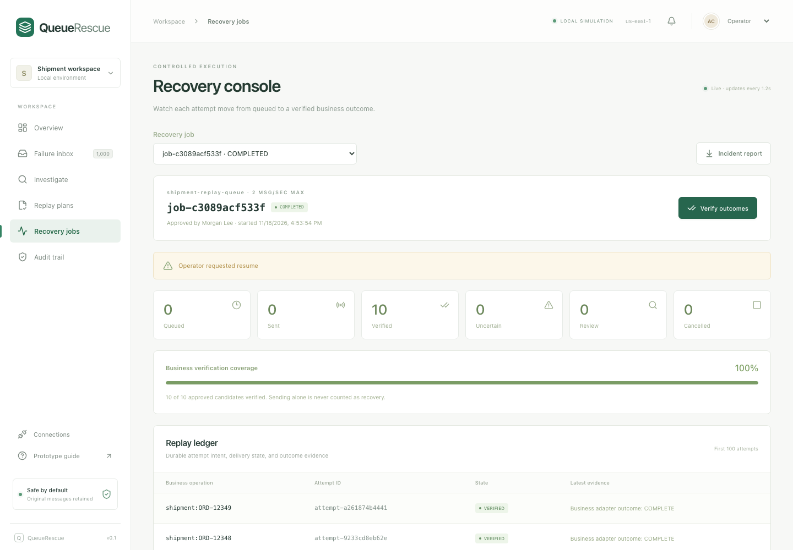

# QueueRescue prototype

A working local implementation of the supplied technical prototype: investigate failed shipment events, create a selective recovery plan, obtain separate approval, replay at a bounded rate, and verify business outcomes.

## Local demo showcase

**Local simulation · synthetic data · no AWS deployment.** Investigate failures, preview exclusions, obtain separate approval, reconcile an interrupted send, and verify the business result.

[Watch or download the short walkthrough (MP4)](docs/media/queuerescue-local-demo.mp4) · [Five-screen gallery and architecture](docs/demo-showcase.md)

[](docs/demo-showcase.md)

The recording uses an isolated fixture: 1,000 original snapshots retained, ten selected operations and ten verified recoveries. The gallery explains the broader dry run and the narrower execution plan. Demo identities and evidence are simulated; real AWS deployment verification remains outstanding.

See the [project completion checklist](docs/project-checklist.md) for verified progress, AWS deployment blockers, remaining features from the brief, and the later full-design phase.

The [paid AWS demo plan](docs/aws-demo-plan.md) records the accepted $1 tolerance and remaining access/deployment reviews. Live checks verified Lambda concurrency of 1,000. A real saved idle plan proposes 64 creates and passes [selected safety checks](docs/aws-plan-review.md); service/bootstrap permissions and deployment review remain outstanding. No infrastructure has been applied.

For the cloud demo, see [AWS cost controls](docs/aws-cost-controls.md). Fresh Terraform configuration defaults to the minimal profile with consumers and replay off. This reduces fixed-cost features and preserves service-owned encryption, but Free Tier eligibility and credits must be checked in the account before deployment. Budget notifications are not a hard spending cap.

**The default application runs locally in simulation.** It implements the recovery workflow with a React dashboard, Python API, SQLite ledger, and simulated idempotent shipment service. An explicit AWS dashboard mode now connects Cognito sign-in and the cloud recovery API; see [dashboard setup](docs/dashboard-aws.md). The AWS backend, browser integration, and Terraform are implemented and tested offline; the stack has not been deployed into the development account. See the [AWS architecture](docs/aws-architecture.md) and [deployment walkthrough](docs/aws-deployment.md). The local dashboard's demo identities are not AWS authentication.

## Run

Requires Node.js 22.12+ (or Node 24) and Python 3.10+. The backend has no external Python dependencies.

```sh
npm ci
npm run build
npm start
```

Open **http://localhost:8000**. The server binds to loopback only. First launch seeds 1,000 synthetic events into `.data/queuerescue.sqlite3`; changes survive restarts. Stop with Ctrl+C.

For frontend development, run `npm start` and `npm run dev` in separate terminals. Open http://localhost:5173; Vite proxies `/api` to port 8000. After editing the frontend, rebuild to update the version served on port 8000.

To use a separate dataset or port:

```sh
python3 -m backend.server --db .data/demo-10k.sqlite3 --seed 10000 --port 8001
```

The seed option applies only to an empty database. To restart the walkthrough with fresh data, stop the server and choose a new `--db` path.

The replay sender and simulated shipment consumer run independently. By default, each accepted delivery waits at least 0.25 seconds before the consumer can create its shipment. Consumer completion still requires an explicit business-verification check to count as a recovery.

To explore delayed processing, bounded consumer retries, or a stopped consumer:

```sh
python3 -m backend.server --db .data/delayed.sqlite3 --consumer-delay 5
python3 -m backend.server --db .data/retries.sqlite3 --consumer-failures 2 --consumer-max-attempts 3
python3 -m backend.server --db .data/stopped.sqlite3 --consumer-disabled
```

Injected consumer failures happen before the shipment effect, separately for each delivery. Retries use exponential backoff starting at 0.1 seconds and stop at the configured attempt limit. A failed consumer delivery stays unverified in the recovery job; it is never automatically replayed again. Restarting with the same database preserves pending work and retry counts. Acknowledging queue delivery and committing a shipment are separate transactions; consumer redelivery deduplicates using the stable business operation ID.

## Demo walkthrough

1. Open **Failure inbox**. Filter by error, age, operation ID, or business outcome. Inspect an event for a masked payload, original identity, checksum, attributes, and simulated failure evidence.
2. As **Operator / Alex Chen**, open **Replay plans → New dry run**. Select all groups or a filter, and set a rate from 1–100 messages/sec. No sends occur during planning.
3. Review the candidates, completed-operation skips, blocked schemas, and manual-review exclusions. Export the complete dry run if desired.
4. Switch the top-right demo identity to **Approver / Morgan Lee**. Add a note and approve the exact plan hash. The API rejects self-approval, changed hashes, and expired plans.
5. Switch back to **Operator**. Optionally enable **Simulate interruption after first send**, then start the approved recovery.
6. In **Recovery jobs**, observe the persisted ledger. An injected interruption produces **PAUSED / UNCERTAIN**. Click **Reconcile outcomes**, then **Resume**. The uncertain message is not resent.
7. When sending reaches **VERIFYING**, click **Verify outcomes**. If the consumer is still processing, the job becomes **PARTIAL / UNVERIFIED**. Check again after processing completes; late proof moves it to **COMPLETED**. Only confirmed business completions count as recoveries. Export the incident report and inspect **Audit trail**.

To quickly test one eligible event, use operation `shipment:ORD-12345` in a new dry run. The default dataset has 824 warehouse timeouts, 162 invalid-schema events, and 14 already-shipped events. Initially 750 are eligible, 74 require review, 162 are blocked, and 14 are skipped.

## Implemented safeguards

- Server-side capabilities for Viewer, Operator, Approver, and Admin; separate creator and approver identities.
- Allowlisted standard source/destination queues; alternate destinations and FIFO are rejected.
- Immutable versioned plans, SHA-256 hashes, one-hour approval/execution windows, schema validation, and immediate pre-send business verification.
- Stable business `operationId` plus per-send replay job/attempt attributes; original payload bytes and attributes preserved in simulated deliveries.
- Transactions reserve operations across overlapping jobs. No automatic retry of an uncertain send. Unresolved operations remain reserved for manual investigation.
- Persisted attempt intent and lease recorded before delivery. Transport delivery and acknowledgment use separate commits to exercise the real ambiguity boundary.
- Rate-limited scheduling, pause/resume/cancel, restart detection, business verification, and reports. Cancellation leaves already-sent events available for verification.
- Consumer-owned unique shipment identity, default sensitive-field masking, and append-only audit triggers with a verifiable hash chain.
- All domain mutations require an `Idempotency-Key`. Retrying the same actor/key/body returns the original response; a changed request receives HTTP 409.
- Original indexed messages are retained throughout. This prototype has no delete/finalization route.

## API

For the local/cloud boundaries, available agent skills and next implementation milestone, see the [project map](docs/project-map.md).

Routes use the `/api` prefix. Reads require `Authorization: Bearer <demo session token>`. Domain writes also require `Content-Type: application/json` and an `Idempotency-Key` (8–200 characters). The UI supplies these headers.

| Method | Route | Purpose |
| --- | --- | --- |
| POST | `/demo/session` | Local-only persona selection; body `{"role":"Operator"}` |
| GET | `/health`, `/session`, `/overview` | Health, identity, counters |
| GET | `/connections` | Allowlisted simulated connection |
| GET | `/incidents`, `/messages` | Filtered, paginated inventory |
| GET | `/messages/{id}` | Masked snapshot and evidence |
| GET / POST | `/replay-plans` | List plans / create immutable dry run |
| GET | `/replay-plans/{id}` | Complete plan and exclusions |
| POST | `/replay-plans/{id}/approve` | Approve with `planHash` and `note` |
| GET / POST | `/replay-jobs` | List jobs / start with `approvedPlanId` |
| GET | `/replay-jobs/{id}` | State, counters, first 100 ledger entries |
| POST | `/replay-jobs/{id}/{pause,resume,cancel}` | Operator controls |
| POST | `/verifications` | Verify/reconcile with `jobId` |
| GET | `/replay-jobs/{id}/report` | Exportable recovery report |
| GET | `/audit` | Paged audit records and hash-chain validation |

Inventory filters: `queue`, `error`, `search`, `outcome`, `hours`. Inventory/audit pagination: `cursor` and `limit` (default 25, maximum 100). Plan/job lists currently return the most recent 100 records. Report counts distinguish exclusions at planning from unresolved execution attempts.

## Verification

```sh
npm test
npm run benchmark
npm run build
```

The tests cover duplicate request/start handling, unknown outcomes, malformed events, payload masking, snapshot/plan tampering, approval expiry, independent approval, role enforcement, allowlists, overlapping operation reservations, cancellation, pause, actual worker pacing, crash-after-send reconciliation, durable restart recovery, HTTP pagination, and audit integrity. Async tests additionally cover delayed consumption, exponential retry backoff and exhaustion, poison deliveries, duplicate consumption, expired consumer leases, verifier outages, late completion, and independent sender/consumer threads.

Two subprocess tests terminate a child with SIGKILL precisely after transport acceptance or shipment creation. They reopen the persisted database and prove reconciliation without a second send or duplicate shipment. These tests use temporary databases and never stop an application server or process outside the test. Clock-based tests advance simulated time instead of sleeping through lease expiry or retry backoff. Existing prototype databases receive an additive consumer-queue migration; completed historical shipments are not processed again.

The backend benchmark measures five fresh 10,000-event SQLite databases, reporting median/range and nearest-rank p95 for indexing, grouping, overview, page selection, planning and plan serialization. Use `npm run benchmark -- --runs 5 --messages 10000` to repeat it. It asserts reconciled decisions, retained originals and zero jobs/sends. `python3 -m backend.benchmark_plans` compares compact saved-plan lists with equivalent legacy full-document lists on the same fixture. The separate opt-in browser fixture exercises the actual production UI; see the [measured benchmark report and reproduction steps](docs/benchmark-report.md). These benchmarks are local simulations, not AWS throughput or billing results. The test suite binds an ephemeral loopback port for HTTP integration tests.

The local `GET /api/replay-plans` returns at most 100 summaries with `id`, `state`, `expired`, `filters`, `rate`, `counts` and `selectedCount`. Fetch `GET /api/replay-plans/{id}` for the full immutable document, decisions, hash and approval details. Existing local databases receive an additive summary backfill on startup; full documents and recovery authority remain intact. The dashboard shows loading/retry states and ignores responses from an older selection. AWS mode keeps its separate catalog contract.

[GitHub Actions CI](https://github.com/ZhiminxCODE/QueueRescue/actions/workflows/ci.yml) runs on every push and pull request, and can also be started manually. It runs the backend suite on Python 3.10 and 3.13, the dry-run benchmark on Python 3.13, and a locked dependency install plus frontend build on Node 24. Official actions are pinned to commit revisions; the workflow has read-only repository permissions and requires no AWS credentials.

Additional CI jobs install the pinned AWS SDK/test emulator, run offline AWS adapter/recovery tests, build the Lambda package, validate Terraform, and assert sandbox safety using mocked AWS plans. To run all AWS SDK tests locally, install `requirements-aws-test.txt` into `.venv` and run `.venv/bin/python -m unittest discover -s tests -v`. Without those optional dependencies, the local simulator suite still runs and the AWS SDK tests report a skip.

## Project layout

```text
src/                   React dashboard, API client, responsive CSS
backend/service.py     Recovery protocol, persistence, simulated transport
backend/simulator.py   Independent shipment consumer, retries, leases, deduplication
backend/server.py      Loopback HTTP API, demo sessions, static asset host
backend/benchmark.py   Reproducible 10,000-event index/plan benchmark
tests/                 Safety, persistence, and HTTP integration tests
cloud/                 AWS API, collector, ledger adapters, replay and shipment Lambdas
infra/aws/             Terraform sandbox, pinned provider, mocked safety tests
tools/                 Deterministic packaging and authenticated AWS console helper
docs/                  AWS architecture, deployment, verification, and teardown guidance
```

## Prototype boundaries and next phase

Demo sessions deliberately let anyone on this local machine select a role. They are in-memory, expire after eight hours, and are invalidated by server restarts. This is not production authentication; do not expose the local server publicly. Snapshots and simulated payloads are plaintext in the local database. Audit triggers/hash chains are useful local integrity checks, not independent tamper-proof storage against a database administrator.

The simulated consumer processes accepted deliveries asynchronously and commits shipment effects separately from queue acknowledgment. A unique local shipment key demonstrates business idempotency; it does not prove universal exactly-once behavior. The verifier supports an injected status adapter for outage/invalid-response tests and conservatively returns UNKNOWN on connection failures or timeouts. Real remote adapters still need authenticated endpoints, bounded network timeouts, freshness policy, and customer-specific idempotency contracts. Evidence is simulated; the app does not invent real CloudWatch or trace links.

The separate AWS sandbox implements DynamoDB conditional writes, encrypted S3 evidence, real SQS/Lambda handlers, Standard Step Functions execution, Cognito/API Gateway authorization, scoped IAM/KMS, opt-in non-destructive collection, alarms, an optional budget alert, and Terraform. The browser supports Cognito PKCE sign-in, role-aware collection/selection, immutable plans and separate approval, job controls and verification, audit pages, connections, and durable same-key request recovery. AWS views refresh manually to avoid idle polling. Real account deployment and browser/service-level validation remain outstanding. Scoped CloudWatch correlation, retention warnings and incident reports with JSON/Markdown export are implemented and verified offline. Reports distinguish recorded business completion, partial history and Admin-declared cost observations from fresh verification or independently validated billing. Large workloads, external verifier credentials/freshness policy, stronger administrator separation for audit archives, automated billing attribution, manual resolution and explicit source finalization remain later work. See [cloud incident reports](docs/cloud-incident-reports.md). Infrastructure has intentionally not been provisioned during this implementation.

Relevant platform semantics checked against the primary AWS documentation:

- [SQS DLQ redrive](https://docs.aws.amazon.com/AWSSimpleQueueService/latest/SQSDeveloperGuide/sqs-configure-dead-letter-queue-redrive.html): redrive assigns new message IDs and does not provide filtering/modification within a move task.
- [Lambda with SQS](https://docs.aws.amazon.com/lambda/latest/dg/with-sqs.html): processing is at least once; consumers must handle duplicates safely.

The supplied Word specification is retained unchanged.

Opt-in [CloudTrail and protected audit archival](docs/cloud-audit.md) are prepared offline with scoped capture, full stream-record archives, Governance retention, bounded failure handling and alarms. Provisioning and capture default off; this adds costs and a sixth active Lambda reservation that the baseline cost worksheet does not cover. The controls require a separate reviewed deployment and live verification.

Optional [private S3 + CloudFront dashboard hosting](docs/dashboard-hosting.md) is prepared and tested offline. Provisioning and delivery default off. An isolated release tool builds AWS-only files under ignored `.data/` without changing the running local dashboard; publication requires a reviewed account/cost/deployment plan.

[Offline IAM role-access preparation](docs/aws-role-access.md) now provides a minimal runtime boundary proposal, exact-role/service delegation fragment and optional Terraform boundary attachment. No account permissions are granted; full deployment permissions, costs and quotas still require review.

Deployment preparation now includes [scoped service policy proposals](docs/aws-service-access.md) and [offline saved-plan checks](docs/aws-plan-review.md). They produce private review files without granting access, provisioning resources or changing the running local application.
