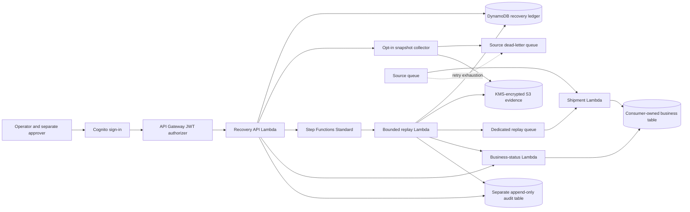

# AWS sandbox architecture

QueueRescue will run inside a single customer AWS account and region. This first AWS implementation is a development sandbox with a real SQS/Lambda shipment workflow, durable evidence, a recovery ledger, authenticated API, and controlled execution. The local simulator remains available independently.

No AWS credentials are needed to build, package, validate, or run the offline tests. Applying the Terraform stack and proving service behavior require an authenticated development account. Nothing in CI deploys resources.

## Safety boundaries

- The collector is explicitly invoked; it is never an SQS event source mapping on the source DLQ. Receiving temporarily changes visibility. The collector snapshots the exact body and original attributes, records integrity hashes, and never deletes originals.
- Only an allowlisted standard replay queue is writable by the replay role. Original messages remain in the source DLQ. Source finalization is outside this sandbox release.
- An application-owned verifier must explicitly return NOT_STARTED before a shipment event is eligible. Missing, invalid, timed-out, IN_PROGRESS, and UNKNOWN outcomes block replay. COMPLETE operations are skipped.
- The shipment service uses a conditional business-state write keyed by operation ID. This demonstrates idempotency for this synthetic domain; it does not establish exactly-once delivery for arbitrary external providers.
- Plans are versioned, expire, and bind message checksums, consumer version, destination, rate, and exclusions. An approver distinct from the creator must approve the exact hash.
- Operation reservations, job state, request idempotency records, and audit events are committed transactionally. Reservations for uncertain side effects do not expire automatically.
- A send intent is committed before SendMessage. SDK transport retries are disabled for replay sends. A timeout or a replay-worker crash is reconciled through business outcome; it is never interpreted as evidence that sending failed.
- Step Functions carries job identifiers, not payloads. The worker sends a bounded chunk per invocation and honors pause/cancel between sends. It does not use broad automatic task retries around uncertain side effects.
- The audit table has a separate IAM boundary: application roles can append and read, but cannot update or delete audit items. Account administrators remain privileged; independently protected archival storage is a later hardening step.

## Deployment boundaries

Terraform creates isolated sandbox queues, recovery/business/audit tables, encrypted evidence storage, function roles and logs, JWT-authenticated API routes, Cognito groups, recovery orchestration, and an optional budget notification. Fresh defaults use the minimal profile with service-owned encryption, fixed small provisioned tables and workers off. The optional standard profile adds a customer-managed KMS key, on-demand tables, PITR and metric alarms. No NAT gateway, EC2, ECS, or public S3 bucket is needed. Neither profile guarantees zero charges; see the [cost assessment](aws-cost-assessment.md).

The React dashboard defaults to local simulation and also supports an explicit AWS mode with Cognito PKCE sign-in and the authenticated cloud API. The demo role selector is never accepted as AWS identity. Browser workflows have been checked offline; real Cognito/CORS validation and hosted frontend deployment must not be implied by successful infrastructure validation. See [dashboard setup](dashboard-aws.md).

Initial AWS plans are deliberately bounded to a small number of snapshots so operation reservations and approval consumption fit within one DynamoDB transaction. Large inventory/replay scaling is a separate milestone; the local 10,000-event planning benchmark is not an AWS throughput result.

## Required deployment inputs

Before deployment, provide the development account ID, region, local AWS profile name, budget alert email/amount, and the callback URL for eventual browser sign-in. Use synthetic messages only during initial validation. Terraform state and local deployment outputs stay out of Git.

The account must permit creating scoped IAM roles, queues, tables, S3 storage, Lambda functions, API Gateway, Cognito, Step Functions, CloudWatch resources, and optionally AWS Budgets. The standard profile also needs KMS permissions. The stack checks the target account before creating resources.

## Validation strategy

Offline tests exercise real AWS SDK request shapes, conditional conflicts, absent verifier proof, duplicate consumer delivery, approval and idempotency decisions, uncertain-send behavior, and non-destructive collection. Terraform formatting, validation, and mocked-provider plan assertions run without customer credentials. A deterministic Lambda package is generated locally.

After account access is available, run a reviewed Terraform plan, deploy the sandbox, seed synthetic operations, observe source failures reaching the DLQ, opt into collection, approve and execute a filtered plan, verify business outcomes, and measure actual usage. Retain the execution and verification results as evidence. Teardown is documented separately from protected evidence retention.

## Primary implementation references

- [Lambda with SQS](https://docs.aws.amazon.com/lambda/latest/dg/with-sqs.html)
- [Lambda partial batch responses](https://docs.aws.amazon.com/lambda/latest/dg/services-sqs-errorhandling.html)
- [DynamoDB transactional writes](https://docs.aws.amazon.com/amazondynamodb/latest/developerguide/transaction-apis.html)
- [Step Functions error handling](https://docs.aws.amazon.com/step-functions/latest/dg/concepts-error-handling.html)
- [API Gateway JWT authorization](https://docs.aws.amazon.com/apigateway/latest/developerguide/http-api-jwt-authorizer.html)
