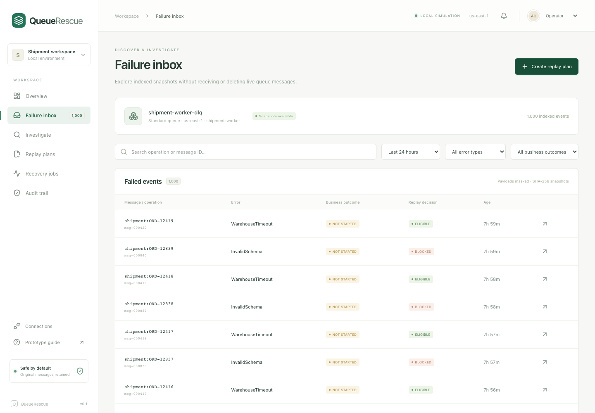
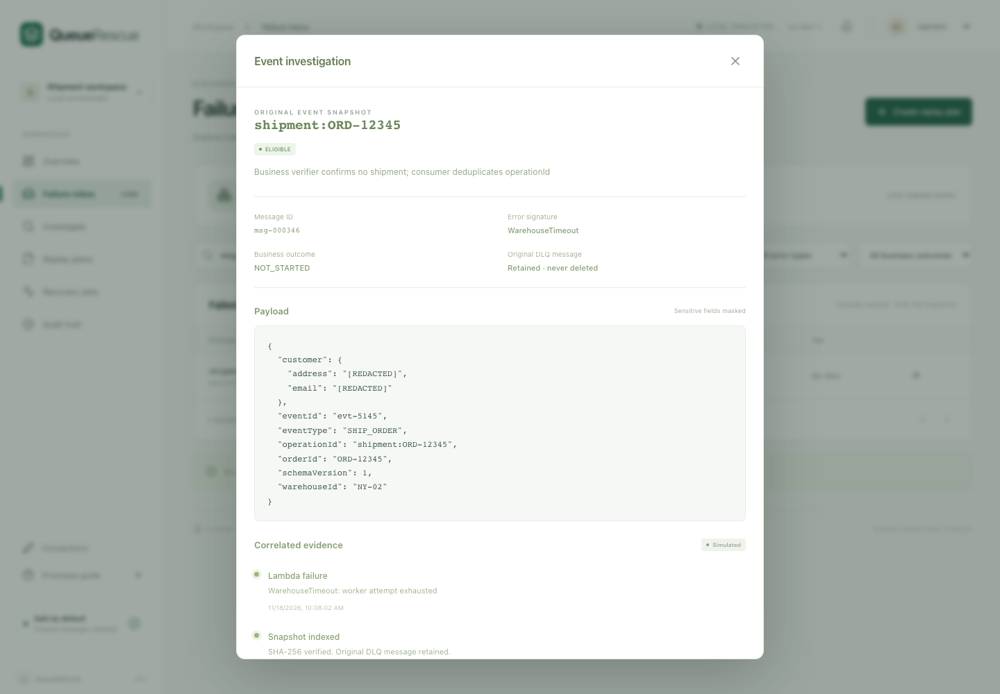
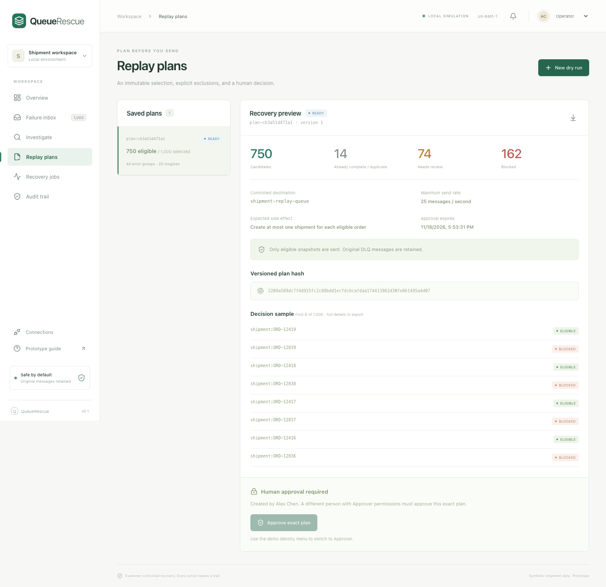
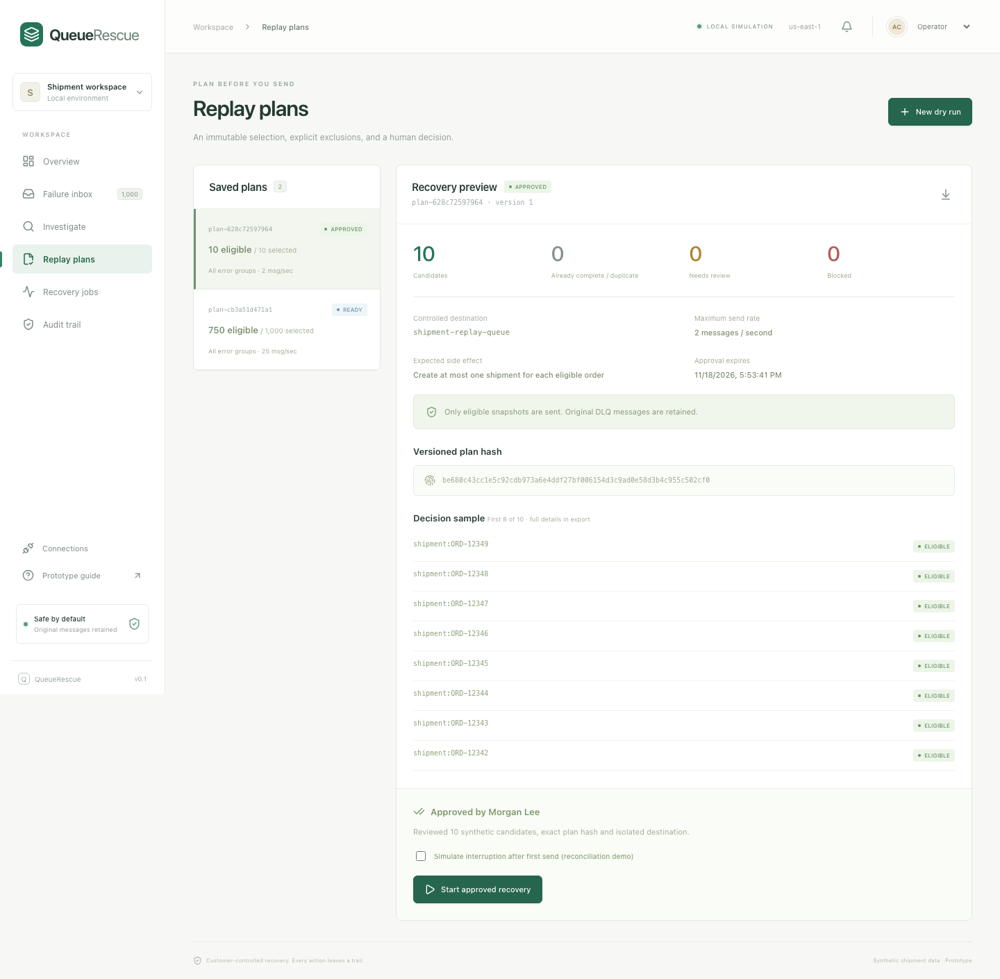
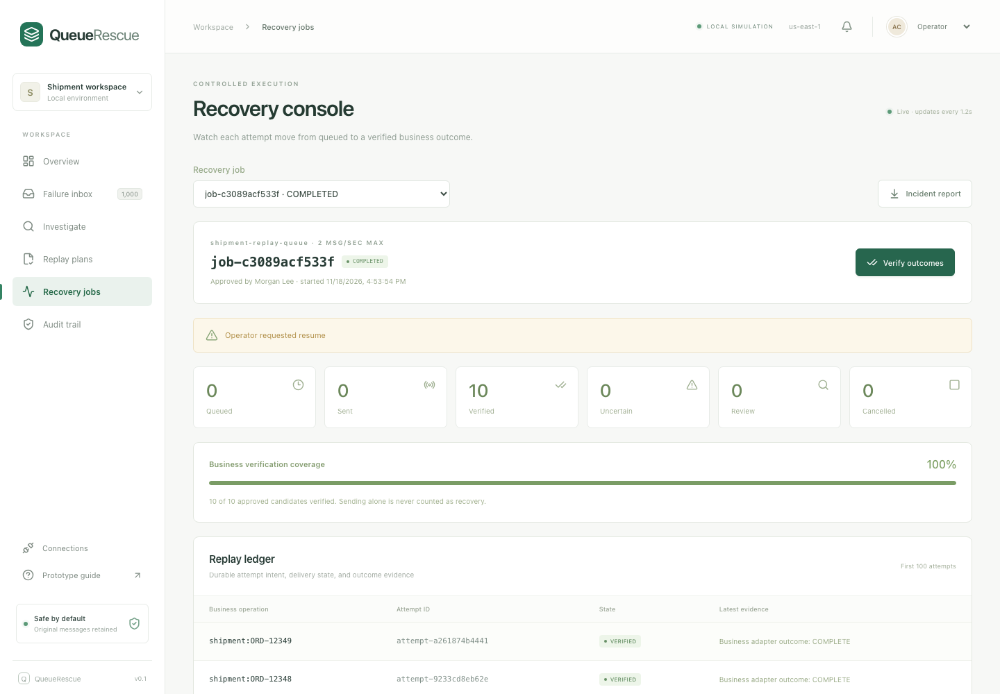
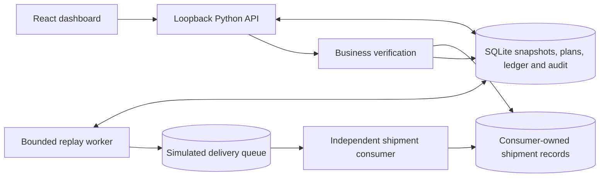

# Local demo showcase

Captured November 18, 2026 from the actual QueueRescue React interface and Python/SQLite simulator, using an isolated fixture of 1,000 synthetic shipment events. The demo identities and evidence are simulated. The AWS implementation is prepared and tested offline; a real AWS deployment has not been verified.

[Watch or download the short walkthrough (MP4)](media/queuerescue-local-demo.mp4). This is a silent, scripted browser recording. The screenshots below open at full resolution.

## 1. Investigate failed events

Search and filter retained snapshots by error and business outcome. Inspection reads the local indexed snapshot; it does not receive or delete messages from a real queue.

[](media/01-failure-inbox.png)

## 2. Inspect a masked snapshot

The selected synthetic order is `shipment:ORD-12345`. Customer contact fields are masked, the original is retained, and the failure evidence is explicitly labeled simulated.

[](media/02-masked-inspection.png)

## 3. Preview the full fixture before sending

The first dry run covers all 1,000 snapshots: 750 eligible candidates, 14 already complete, 74 needing review and 162 blocked. This preview sends nothing. The versioned hash binds the selection and replay settings to the later approval.

[](media/03-dry-run-plan.png)

## 4. Approve a smaller, explicit selection

For execution, the walkthrough creates a second plan using `shipment:ORD-1234`, selecting the ten eligible operations `ORD-12340` through `ORD-12349` at a maximum of two messages per second. Operator Alex Chen creates the plan; the separate simulated Approver Morgan Lee approves its exact hash. The screen then returns to Operator for execution. The broad 1,000-event plan remains unexecuted.

[](media/04-separate-approval.png)

## 5. Reconcile and verify the business result

The run deliberately interrupts the worker after its first send and before acknowledgement. It pauses with one uncertain delivery and nine queued candidates. Reconciliation checks business evidence before enabling resume; completion requires a separate verification action.

The finished capture has ten verified attempts, ten delivery records for ten distinct operations, and all 1,000 original snapshots retained. The local database contains 24 shipment records: 14 pre-existing seeded completions and ten created by this recovery. These are observations from this synthetic scenario, not an AWS performance or billing result.

[](media/05-verified-recovery.png)

[See the intermediate paused/uncertain state](media/06-interruption-reconciliation.png). The video also ends on the local audit trail with a verified hash chain.

## How it works



The queue, ledger and shipment records are tables in the isolated SQLite fixture. The replay worker and consumer run independently, which lets the demo exercise the gap between accepting a delivery and observing its business effect. Verification uses shipment proof before marking attempts recovered. Local demo personas demonstrate API-enforced role separation; they are not AWS authentication. The [separate AWS architecture](aws-architecture.md) uses Cognito, API Gateway, Lambda, SQS, DynamoDB, S3 and Step Functions.

## Reproduce the capture

The optional capture tool leaves existing `dist/`, `.env` and `.env.local` unchanged. It builds local mode into a new ignored `.data/showcase-*` directory, creates a fresh database, binds a new loopback port selected by the OS, and opens a fresh headless browser context. Browser requests are restricted to that fixture's origin. It checks visible masking, workflow states, browser errors and protected-file hashes, then closes only its own server/browser. No AWS calls or permission changes are involved.

From the repository root, with Node 24, Python 3.10+ and the platform dependencies needed by Playwright:

```sh
npm ci
python3 -m venv .venv
npm install --prefix .data/showcase-tools --no-save --no-audit --no-fund --ignore-scripts playwright@1.58.2
.data/showcase-tools/node_modules/.bin/playwright install chromium
node tools/capture_local_demo.mjs
```

The tool prints the capture directory and saves its location in ignored `.data/showcase-latest.json`; require `captureComplete: true` before reviewing a run for publication. Its `media/` folder contains the screenshots and original WebM recording. IDs and timestamps vary between runs. For a broadly supported MP4, encode that recording with FFmpeg without changing playback speed:

```sh
ffmpeg -i .data/showcase-RUN/media/queuerescue-local-demo.webm \
  -c:v libx264 -crf 23 -pix_fmt yuv420p -movflags +faststart -an \
  .data/showcase-RUN/media/queuerescue-local-demo.mp4
```

Replace `showcase-RUN` with the printed directory. Verify the completed fixture, inspect every screenshot and the video, and publish only the curated media you reviewed. The published MP4 is an encoding of the continuous browser recording; the screenshots are direct browser captures. Application source and rendered business states were not edited for presentation. Raw recordings, logs, capture metadata, databases, browser profiles, dependencies and build output stay ignored. The curated synthetic screenshots and MP4 are the public showcase requested for this repository.

GitHub serves the repository media independently of AWS. Readers can watch the capture or follow the main [local setup instructions](../README.md#run); a running cloud stack is not needed to view these files.
