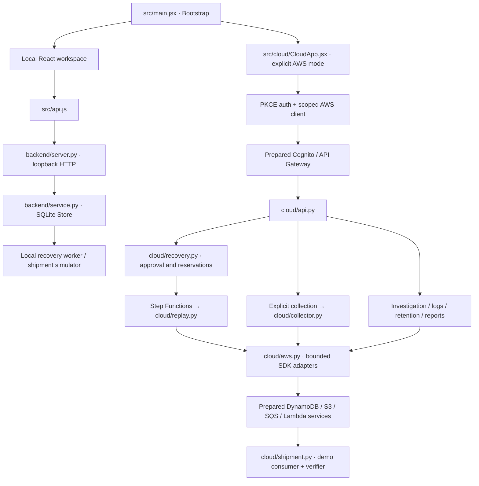

# Project map and agent skills

This map separates the working local simulator from the prepared, undeployed AWS sandbox. Use [the project checklist](project-checklist.md) for outstanding milestones and [AWS architecture](aws-architecture.md) for the detailed cloud design.

## Available skills

The local skill inventory contains `karpathy-guidelines`, the Graphify skill, and 49 ECC-directory `SKILL.md` files (including Karpathy). Availability means the instruction file exists; it does not prove every optional external tool/service used by every skill is configured. `module-regression` is present on disk but was not advertised in the current skill catalog.

Karpathy's guidelines apply to future implementation/review: expose assumptions, choose the simplest adequate change, avoid unrelated edits and verify concrete success criteria. Relevant ECC choices include `change-impact` for cross-module changes, `api-design` for endpoint contracts, `frontend-patterns` for React state/performance, `security-review` for authentication/IAM/input/secrets, and `test-collaboration`/`tdd-workflow` for meaningful regression evidence. Read each selected skill first; do not load every installed skill for routine work.

Installed ECC-directory skill names:

`agent-introspection-debugging`, `agent-sort`, `api-design`, `article-writing`, `backend-patterns`, `benchmark-methodology`, `brand-discovery`, `brand-voice`, `bun-runtime`, `change-impact`, `coding-standards`, `competitive-platform-analysis`, `competitive-report-structure`, `content-engine`, `context-and-decisions`, `crosspost`, `deep-research`, `dmux-workflows`, `docs-governance`, `documentation-lookup`, `e2e-testing`, `ecc-contribution-review`, `ecc-conventions`, `eval-harness`, `exa-search`, `fal-ai-media`, `frontend-patterns`, `frontend-slides`, `investor-materials`, `investor-outreach`, `karpathy-guidelines`, `market-research`, `mcp-dependency-review`, `mcp-server-patterns`, `mle-workflow`, `module-governance`, `module-regression`, `nextjs-turbopack`, `plan-canvas`, `product-capability`, `security-review`, `skill-host-compat`, `strategic-compact`, `tdd-workflow`, `test-collaboration`, `unified-memory`, `verification-loop`, `video-editing`, `x-api`.

Graphify's CLI was initially absent. Version 0.9.111 was installed with Terraform/Office parsers into a separate temporary Python 3.14 environment; application dependencies were not changed. Its interpreter location is recorded in ignored `graphify-out/.graphify_python`. Recreate that isolated environment if temporary files are removed. No API key or external LLM service is needed for this agent-driven map.

## Executable structure

Arrows summarize verified imports, configured handlers and protocol flow; they are not a trace of a live AWS deployment. The local worker and simulated shipment consumer are independent from cloud service delivery. The live application was not restarted, rebuilt, polled or otherwise operated during mapping.

| Area | Responsibility and evidence |
| --- | --- |
| `src/main.jsx`, `src/api.js`, `src/local/plans.js` | Mode selection, local screens and demo-session API calls. Saved-plan lists use summaries; only selected details load in full. |
| `backend/server.py`, `backend/service.py`, `backend/simulator.py` | Loopback API, SQLite transactions, planning/approval/recovery, local worker and synthetic business verification. No AWS transport in this runtime. |
| `src/cloud/` | Explicit AWS configuration, PKCE login, authenticated API calls, request reconciliation and manually refreshed evidence/reporting views. |
| `cloud/contracts.py`, `cloud/aws.py` | Access-token/group checks, event/settings validation, serialization, scoped SDK clients and conditional transactional repository writes. |
| `cloud/recovery.py`, `cloud/replay.py`, `cloud/shipment.py` | Immutable plans, separate approval, reservations, send-attempt states, conservative uncertain-send handling and business-result verification. |
| `cloud/collector.py`, `cloud/investigation.py`, `cloud/retention.py` | Explicit DLQ receive/snapshot collection, sampled incident membership and distinct original-message/snapshot retention estimates. Collection changes visibility but never deletes originals. |
| `cloud/telemetry.py`, `cloud/log_evidence.py`, `cloud/reports.py`, `cloud/report_index.py`, `cloud/report_costs.py` | Sanitized correlation, bounded evidence lookup, report indexes/findings and separately labeled cost provenance. |
| `infra/aws/hosting.tf`, `infra/aws/functions/dashboard-routing.js`, `tools/prepare_dashboard_release.mjs` | Optional private static origin/CDN, exact OAuth callback routing, and an isolated AWS-only release; hosting outputs feed Cognito callbacks and API CORS. |
| `infra/aws/` | Prepared storage, IAM, encryption, worker switches, Cognito/API Gateway, orchestration, alarms/budget notices and mocked Terraform safety plans. |
| `tests/`, `tools/`, `.github/workflows/ci.yml` | Safety/HTTP/SDK fixture/frontend tests, packaging/readiness/configuration tools and reproducible offline validation. Tools that access real AWS remain subject to separate deployment authorization and cost review. |

One cross-runtime dependency deserves attention: `cloud/api.py` imports `mask` from `backend/service.py`. Packaging therefore includes that backend module; this is shared redaction code, not a cloud call into the local SQLite server. `cloud/reports.py` imports recovery attempt-state definitions, so recovery-state changes can also affect reporting.

## Next milestone

Opt-in CloudTrail coverage and protected audit retention are now [implemented and verified offline](cloud-audit.md), including scoped data selectors, an audit-stream writer, Governance-retained S3 versions, failure capture and alarms. Provisioning/capture default off; real delivery, enforcement and audit completeness remain deployment checks. Optional [private S3 + CloudFront hosting](dashboard-hosting.md) is also implemented and verified offline, with exact callback routing, cache/security controls and an isolated release builder; provisioning/delivery default off. Do not claim audit records are tamper-proof against account administrators.

A real deployment separately needs reviewed account plan/credits/shared allowances, scoped deployment permissions, a quota-compatible Lambda design and a concrete saved Terraform/cost plan. The next milestone is account readiness: establish the cost path, resolve permissions and Lambda quota constraints, then prepare a concrete saved plan for review before any deployment. No deployment or paid workload is authorized by this map.

## Graphify snapshot

The generated interactive graph (`graphify-out/graph.html`), JSON (`graphify-out/graph.json`) and audit report (`graphify-out/GRAPH_REPORT.md`) live in ignored `graphify-out/`. The snapshot contains 946 nodes, 2,990 relationships and 39 labeled communities from 97 supported files (78 code, 19 documents; about 65,446 words). This authored guide was written after that source snapshot and is not self-indexed. Code was parsed statically, and documents (including a converted prototype brief) were mapped semantically. The prototype brief describes desired scope; it is not proof of implemented or deployed behavior. Secret/local deployment settings, databases, dependencies, runtime evidence and builds were excluded. This authored map and skill inventory are documentation; generated analysis/cache artifacts remain local.

This graph snapshot predates optional audit and dashboard hosting; check query results against `infra/aws/audit.tf`, `cloud/audit_archive.py`, `infra/aws/hosting.tf`, `tools/prepare_dashboard_release.mjs` and their runbooks until it is refreshed. The existing graph was queried before this hosting change; source inspection supplied the newer relationships without rebuilding or disturbing the application.

The graph is an analysis aid, not a complete call graph. Dynamic SDK calls, callbacks, decorators and infrastructure runtime wiring may need source inspection. Parser limitations and graph health findings are recorded in the generated report. A graph-derived connection is not independent evidence of real service behavior or test success.

The graph health check reports 302 unresolved AST endpoints, two self-loops and 109 same-endpoint relationship collapses. Raw extraction and diagnostics are preserved locally for audit; unresolved references are not verified runtime links. Four scanned files yielded no AST symbols: `infra/aws/tests/sandbox.tftest.hcl`, `tests/frontend/configure.test.js`, `tests/frontend/evidence.test.js`, and `tests/frontend/retention.test.js`. All 19 semantic inputs were read to their final line. Host-agent semantic token usage was not exposed, so it is recorded as unavailable; no external LLM API was called.
